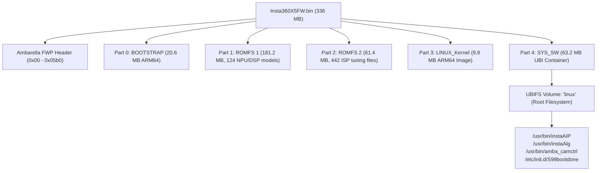
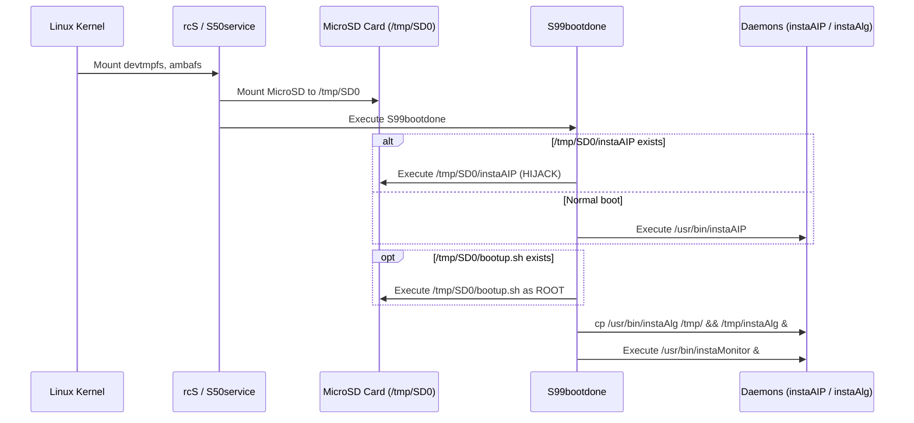
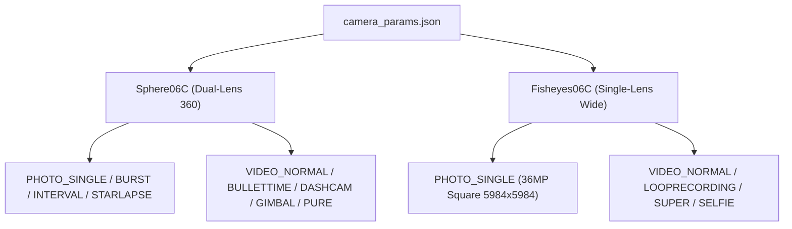

# Insta360 X5 Firmware Reverse Engineering & Architecture Report

> [!NOTE]
> **Target Artifact:** `Insta360X5FW.bin` (~336 MB / 321.05 MiB)  
> **Target Architecture:** Ambarella CV5-series SoC (Asymmetric Multiprocessing: ARM64 Linux 5.10 + RTOS Core + Cavalry NPU / Vector DSP)  
> **Analysis Engine:** Reverse Engineer Anything (REA) & Headless/Interactive Ghidra Bridge (Project `Insta`)

---

## 1. Executive Summary & Container Packaging

The Insta360 X5 firmware is packaged as a proprietary **Ambarella multi-partition container**. The image contains low-level bootloaders, two Ambarella ROMFS partitions hosting hardware neural network models and tuning tables, an uncompressed 64-bit Linux kernel, and a UBI/UBIFS root filesystem.



### Partition Table Offsets & Layout

| Partition | Start Offset | Header | Payload Size | Filesystem / Type | Contents & Purpose |
| :--- | :--- | :--- | :--- | :--- | :--- |
| **`BOOTSTRAP`** | `0x000005b0` | 256 B | 20,592,167 B | Bare-Metal ARM64 | First/Second stage bootloader & ARM Trusted Firmware (BL2/ATF). |
| **`Part 1 (Drive A)`** | `0x013a3cd7` | 256 B | 181,268,480 B | Ambarella ROMFS (`0x66fc328a`) | 124 files: Neural network models, PureShot de-noise, optical flow, thermal SVR models. Mounted to `/tmp/FL0`. |
| **`Part 2 (Drive B)`** | `0x0c082dd7` | 256 B | 61,423,616 B | Ambarella ROMFS (`0x66fc328a`) | 442 files: Sensor calibration (`imx586.db`), AI-ISP RTOS bin, multilingual voice prompts. Mounted to `/tmp/FL1`. |
| **`LINUX_Kernel`** | `0x0fb16ed7` | 256 B | 9,875,464 B | ARM64 Linux Kernel | Raw uncompressed Linux kernel (`ARMd` magic at offset `0x38`). |
| **`SYS_SW`** | `0x10481fdf` | 256 B | 63,176,704 B | **UBI / UBIFS** | Root Linux filesystem volume `linux`. Extracted to `extracted_sys_sw/`. |
| **`SECURE`** | `0x140c20df` | 256 B | 39,552 B | Flattened Device Tree | SoC hardware device tree blob (`0xd00dfeed`). |
| **`SYS_DATA`** | `0x140cbc5f` | 256 B | 42,604 B | Flattened Device Tree | Secondary device tree blob (`0xd00dfeed`). |

---

## 2. Boot Sequence & The Built-in SD Card Execution Hook

The system initializes via `/init` -> `/sbin/init` -> `/etc/init.d/rcS`.



### The Built-in Vendor SD Card Hijack Engine

In [`/etc/init.d/S99bootdone`](file:///c:/Users/shane/Documents/Ghidra/X5_FW/extracted_sys_sw/843464317/linux/etc/init.d/S99bootdone), the boot sequence explicitly contains hooks allowing root code execution and binary replacement directly from the microSD card:

```sh
# 1. Daemon Hijack Hook (Lines 43-50):
if [ -x /tmp/SD0/instaAIP ]; then
    LOG 'hijack instaAIP'
    /tmp/SD0/instaAIP &
else
    if [ -x /usr/bin/instaAIP ]; then
        /usr/bin/instaAIP &
    fi
fi

# 2. Synchronous Root Script Injection Hook (Lines 63-71):
if [ -x /tmp/SD0/bootup.sh ]; then
    LOG "inject SD0 boot.sh"
    /tmp/SD0/bootup.sh
else
    if [ -x /tmp/SD1/bootup.sh ]; then
        LOG "inject SD1 boot.sh"
        /tmp/SD1/bootup.sh
    fi
fi

# 3. Auto-run script hook (Lines 74-77):
if [ -x /mnt/SCAM/cv1_auto_run.sh ]; then
    LOG 'Auto-run user script...'
    /mnt/SCAM/cv1_auto_run.sh
fi
```

> [!IMPORTANT]
> **Zero-Risk Modification Path:**  
> You **do not** need to reflash the NAND partition to test custom software or modify behaviors. Placing an executable shell script named `bootup.sh` on the root of your microSD card will run it with full root privileges on every camera boot. If anything misbehaves, removing the SD card restores 100% factory behavior.

---

## 3. Native Daemons & Control Architecture

### 3.1 `instaAIP` (`/usr/bin/instaAIP` - 5.7 MB ARM64 ELF)
`instaAIP` is the primary high-level application daemon managing network, wireless interfaces, device states, and client commands.

* **Embedded HTTP/REST Server**: Built on `libevhtp` and `libevent`.
* **Google Open Spherical Camera (OSC) API**:
  - `/osc/info`: Device capabilities, serial number, firmware version.
  - `/osc/state`: Battery status, storage capacity, recording state.
  - `/osc/checkForUpdates`: Polling for firmware updates.
  - `/osc/commands/execute`: Dispatches camera capture commands, parameter changes, and mode switches.
  - `/osc/commands/status`: Monitors execution of asynchronous commands.
* **Configuration Search Order**:
  `instaAIP` queries `/pref/camera_params.json` before falling back to `/usr/local/share/script/camera_params.json`. Because `/pref/` is a read-write flash partition, overriding parameters persistently is native to the camera.
* **Wi-Fi Regulatory Domain Management**:
  `instaAIP` uses `wl -i wlan1 country` and `/usr/local/bcmdhd/dhd_priv country "<CC>"` to configure 5 GHz channels. It executes `/usr/local/share/script/wifi_setfreq.sh` and `ap_start.sh` to restart `hostapd` and `dnsmasq`.

### 3.2 `amba_camctrl` (`/usr/bin/amba_camctrl` - 22 KB ARM64 ELF)
`amba_camctrl` is the low-level command client interfacing directly with the Ambarella RTOS video pipeline via `ambaipc_clnt_call`:

* **Encoder (`enc`) Commands**:
  - `amba_camctrl enc set_bitrate <bps>` (Command ID: `0xf0020002`): Directly updates the hardware video encoder bitrate in bits per second at runtime.
  - `amba_camctrl enc set_framerate <fps>` (Command ID: `0xf0020003`): Adjusts sensor capture and encoding framerate.
  - `amba_camctrl enc set_resolution <id>` (Command ID: `0xf0020001`): Selects the encoder resolution profile.
* **Image Sensor (`img`) Commands**:
  - `amba_camctrl img set_evbias <ch> <val>`: Exposure bias (32 = +1 EV, 0 = 0 EV, -32 = -1 EV).
  - `amba_camctrl img set_de <ch> <val>`: Detail enhancement / sharpening.
  - `amba_camctrl img set_scene <ch> <vin> <val>`: Ambarella ISP scene mode selection.
  - `amba_camctrl img set_slowshutter <ch> <mode> <val>`: Slow shutter mode.
* **System (`sys`) Commands**:
  - `init_dsp`, `en_lv` (liveview enable), `en_hdr` (HDR enable), `conf_lv`, `feed_next`, `stop_feed`, `start_vin`, `stop_vin`.

### 3.3 `instaAlg` (`/usr/bin/instaAlg` - 16.5 MB ARM64 ELF)
The image processing powerhouse. Statically links:
* **`bcv::stitcher`**: Real-time binocular panoramic stitching, seamless Poisson blending (`ImageFusionMGPCpu`), multi-level Laplacian pyramid fusion (`ImageFusionMLPCpu`), and alpha mask generation (`FisheyeMaskMaker`).
* **`inscore::Projections`**: Omnidirectional fisheye lens distortion (`OmniProjection<RadtanDistortPro>`), equidistant mapping, Equirectangular 360 wrap, Pannini projections, and linear perspective pinhole transforms.
* **Ceres Solver**: High-performance non-linear quaternion optimization (`ceres::QuaternionManifold`) for gyro-based FlowState stabilization and 360 Horizon Lock.
* **Alibaba MNN & Vision Analytics (`bva::mmdet`)**:
  - YOLOv5, YOLOv8, YOLOv8-Keypoint, RetinaFace, and Multi-YOLOX heads.
  - Real-time invisible selfie stick inpainting (`det_camholder_968M`).
  - Gesture recognition (`cls_gesture_3M`).
  - Subject tracking (`vot_amba::PersonTrackerLite`).
* **IPC Dispatching**: Dual System V message queues (`ftok('/usr/bin', 'd')` and `'c'`) and Ambarella IPCC channels dispatching 11 concurrent worker threads (`InsIpccAlg_TaskHandler 0..10`).

### 3.4 `instaMonitor` (`/usr/bin/instaMonitor` - 77 KB ARM64 ELF)
A customized Android-style `init` and `property_service` daemon:
* Parses `/etc/init.rc` (which declares `logd`, `adbd`, and `media_server`).
* Listens on `/dev/socket/property_service` for `ctl.start`, `ctl.stop`, `ctl.restart`.
* Implements a non-blocking `waitpid` loop. Abnormal crashes trigger `kill(-pid, SIGKILL)` on the child's process group and execute `onrestart` sequences.

---

## 4. Camera Parameters & Configuration Engine

[`/usr/local/share/script/camera_params.json`](file:///c:/Users/shane/Documents/Ghidra/X5_FW/extracted_sys_sw/843464317/linux/usr/local/share/script/camera_params.json) (7,275 lines) defines every user-facing and hardware option:



### Key Parameter Matrices

* **Resolutions (`record_resolution`)**:
  - `Sphere06C`: 11K 30fps Time-lapse (`11264_5632_30`), 8K 30/25/24fps (`7680_3840`), 5.7K Plus (`5760_2880`), 4K 120/100fps (`3840_1920`), Bullet-Time 5.7K 120fps (`5760_2880_120`), 3K 240fps (`3008_1504_240`), 72MP Still (`11968_5984`).
  - `Fisheyes06C`: 4K 60/50/30/25/24fps (`3840_2160`), 2.7K 120/60fps, 1080p 120/60fps (16:9 and 9:16 vertical), 36MP Still (`5984_5984`).
* **Exposure & Sensor Ranges**:
  - `exposure_iso`: Auto (0), 100, 125, 160, 200, 250, 320, 400, 500, 640, 800, 1000, 1250, 1600, 2000, 2500, 3200, 6400.
  - `video_iso_top_limit`: Auto-ISO ceiling locks (400, 800, 1600, 3200).
  - `exposure_shutter_speed`: Video (1/8000s down to 1/24s); Starlapse/Manual Photo (1/8000s up to 120s bulb).
  - `color_mode`: `STANDARD`, `VIVID`, `FLAT`.
  - `i_log_switch`: 10-bit Log gamma curve enable.
  - `p3_switch`: Apple/DCI-P3 wide color gamut enable.

---

## 5. Thermal Throttling & SVR Prediction Models

Thermal management is located in **Part 1 ROMFS** (`/tmp/FL0`):
* `heat57KProtector.xml` (5.7K recording with lens guard attached)
* `heat57KBare.xml` (5.7K recording bare lenses)
* `heat8KProtector.xml` (8K recording with lens guard attached)
* `heat8KBare.xml` (8K recording bare lenses)
* `heatA3_5200c96b.xml` (Coprocessor thermal profile)

### Model Structure & Logic
* Utilizes **OpenCV Support Vector Regression (`EPS_SVR`)** with a linear kernel:
  $$\hat{T}_{\text{shell}} = \sum_{i=1}^{N} \alpha_i \cdot \mathbf{x}_i - \rho$$
* Dual NTC thermistors (NTC0 on SoC, NTC1 on battery) feed rolling temperature vectors $\mathbf{x}$ into the SVR to predict outer shell surface temperature ($\hat{T}_{\text{shell}}$).
* When $\hat{T}_{\text{shell}}$ exceeds threshold curves:
  1. **Level 1**: UI prompt + LCD backlight brightness reduced.
  2. **Level 2 (`AutoStop`)**: Safe video file finalization.
  3. **Critical (`OVERHEAT`)**: Hard PMIC power cutoff to protect battery chemistry.
* **Integrity Validation**: Each XML is cryptographically signed with an appended 256-byte (2048-bit RSA) signature directly after `</opencv_storage>`.

---

## 6. Practical Feature Modification Recipes (Non-Invasive)

Because of the built-in `/tmp/SD0/bootup.sh` hook, modifications can be executed safely from an SD card without flashing:

### Recipe 1: Enable Root Shell over ADB
Create a file named `bootup.sh` on the microSD card:
```sh
#!/bin/sh
# Start adbd daemon
/usr/bin/adbd &
```
Plugging the camera into a PC via USB will immediately register an ADB device, granting passwordless root shell access via `adb shell`.

### Recipe 2: Enable Root Serial Getty on USB
```sh
#!/bin/sh
# Trigger the built-in USB serial script
/usr/local/share/script/usb_console.sh &
```
Exposes a 115200 baud root serial console over `/dev/ttyGS0`.

### Recipe 3: Non-Invasive Parameter Overrides (Bitrate, Shutter, Modes)
To modify `camera_params.json` without modifying NAND flash:
```sh
#!/bin/sh
# Bind-mount a modified camera_params.json from the SD card over the system file
if [ -f /tmp/SD0/custom_camera_params.json ]; then
    mount --bind /tmp/SD0/custom_camera_params.json /usr/local/share/script/camera_params.json
    mount --bind /tmp/SD0/custom_camera_params.json /pref/camera_params.json
fi
```

### Recipe 4: Force 5.8 GHz High-Speed Wi-Fi Worldwide
Bypass European/Asian DFS restrictions by setting country code `US` or `FCC` and channel `149`:
```sh
#!/bin/sh
# Force US regulatory domain and high-power 5.8 GHz channel
/usr/local/share/script/wifi_setfreq.sh US 149
```
