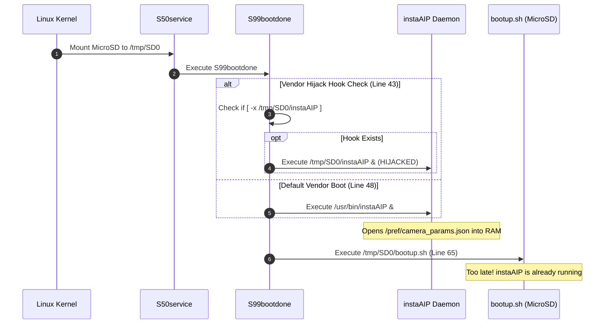
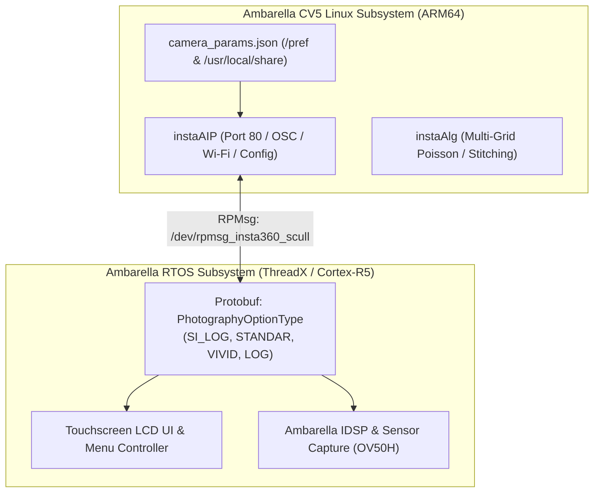

# Insta360 X5: I-Log Architecture & Runtime Modification Guide

> [!NOTE]
> **Subject:** Complete reverse engineering of the Insta360 X5 color profile pipeline, the artificial gating of I-Log, the Linux/RTOS startup sequence, and the non-invasive runtime patch mechanism.  
> **Target Device:** Insta360 X5 (Ambarella CV5 SoC + Dual OV50H Sensors).  
> **Repository Payload:** [`sdcard_payload/`](../sdcard_payload/)

---

## 1. Executive Summary

In stock firmware:
1. **360 Video Mode:** The flat logarithmic color profile (**I-Log**) is **artificially gated**: it is only exposed when **Active HDR is enabled** at 5.7K or 4K. When HDR is turned off, or when shooting in **8K 360**, the I-Log toggle is completely hidden.
2. **Single Lens Modes:** Both standard Flat Video (`VIDEO_NORMAL`) and FreeFrame Video (`VIDEO_SUPER`) have I-Log disabled in the configuration schemas, exposing only standard picture filters (`filter_mode`).

Through decompilation and dynamic testing, we identified how the camera loads configuration profiles, discovered an early-boot vendor hijack hook in the initialization sequence, and implemented a **100% zero-risk MicroSD patch** that enables I-Log across both 360 and Single Lens modes without flashing internal NAND.

---

## 2. Reverse Engineering Findings: Why I-Log Was Restricted

### 2.1 The Artificial HDR Gating in `Sphere06C`
In `/usr/local/share/script/camera_params.json`, the 360 video mode profile (`Sphere06C.VIDEO_NORMAL`) defines `i_log_switch` as:

```json
"i_log_switch": {
    "depend_on": ["hdr_switch", "record_resolution", "p3_switch"],
    "list": {
        "default": ["false"],
        "false|7680_3840_24|false": [],
        "false|7680_3840_25|false": [],
        "false|7680_3840_30|false": [],
        "false|5760_2880_24|false": [],
        "true|5760_2880_24|false": ["true", "false"],
        "true|3840_1920_24|false": ["true", "false"]
    }
}
```

* Notice that any configuration starting with `false|` (where `hdr_switch` is `false`) returns an empty list (`[]`). When the schema evaluates to an empty list, the camera UI suppresses the I-Log toggle.
* Because 8K 360 mode (`7680_3840`) does not support HDR on the CV5 hardware, all 8K entries start with `false|`—meaning **8K I-Log was completely blocked by the stock software schema**.

### 2.2 Complete Omission in Single Lens (`Fisheyes06C`)
In `Fisheyes06C.VIDEO_NORMAL` and `VIDEO_SUPER`, `support_attrs` only contained `filter_mode` (Standard, Vivid, Flat, etc.), completely omitting `i_log_switch` and `color_mode`.

---

## 3. The Boot Sequence & The Timing Race Condition

The camera initializes using SysV init scripts in `/etc/init.d/`:



### Why Initial Bind-Mounts in `bootup.sh` Failed:
1. `S99bootdone` launched `/usr/bin/instaAIP &` at **Line 48**.
2. Upon startup, `instaAIP` opens `/pref/camera_params.json` (or `/pref/camera_params.json.zip`) and parses the entire JSON into in-memory heap structures.
3. `bootup.sh` was not executed until **Line 65** (several seconds later).
4. When `bootup.sh` ran `mount --bind /tmp/SD0/camera_params.json /pref/...`, the mount succeeded in the Linux VFS, but `instaAIP` **never reloaded the file from disk**.

---

## 4. The Solution: Early Boot Daemon Hijack (`/tmp/SD0/instaAIP`)

Lines 43–46 of `/etc/init.d/S99bootdone` contain an explicit backdoor left by Insta360 firmware engineers:

```sh
if [ -x /tmp/SD0/instaAIP ]; then
    LOG 'hijack instaAIP'
    /tmp/SD0/instaAIP &
else
    if [ -x /usr/bin/instaAIP ]; then
        /usr/bin/instaAIP &
    fi
fi
```

By placing an executable script named [`instaAIP`](../sdcard_payload/instaAIP) on the root of the MicroSD card, `S99bootdone` executes our wrapper **instead** of the factory binary:

```sh
#!/bin/sh
# 1. Apply bind mounts over both JSON paths BEFORE the binary starts
mount --bind /tmp/SD0/camera_params.json /usr/local/share/script/camera_params.json
mount --bind /tmp/SD0/camera_params.json /pref/camera_params.json

# 2. Apply bind mounts over zip archive if present
if [ -f /tmp/SD0/camera_params.json.zip ]; then
    mount --bind /tmp/SD0/camera_params.json.zip /usr/local/share/script/camera_params.json.zip
    mount --bind /tmp/SD0/camera_params.json.zip /pref/camera_params.json.zip
fi

touch /tmp/instaAIP_hijacked

# 3. Replace wrapper with the real factory binary
exec /usr/bin/instaAIP "$@"
```

### Multi-Layered Resilience:
As an additional safety net, [`bootup.sh`](../sdcard_payload/bootup.sh) at line 65 inspects `/tmp/instaAIP_hijacked`. If the hijack was missed for any reason, `bootup.sh` immediately applies the mounts and reloads `instaAIP` (`killall -9 instaAIP && /usr/bin/instaAIP &`).

---

## 5. Linux <-> RTOS Inter-Core Architecture

The Insta360 X5 utilizes an asymmetric multiprocessing (AMP) architecture:



* **Touchscreen UI & IDSP:** Run on the real-time RTOS core.
* **Network & Parameter Broker:** Run on the Linux core via `instaAIP`.
* **Inter-Core Communication:** Handled via Ambarella RPMsg (`/dev/rpmsg_insta360_scull`).
* **Protobuf Definitions:** The RTOS contains full compiled protocol buffer definitions for `insta360.messages.PhotographyOptionType`, including `SI_LOG`, `STANDAR`, `VIVID`, and `9LOG`.

---

## 6. How to Deploy the I-Log Patch

1. Ensure the MicroSD card contains the updated files from [`sdcard_payload/`](../sdcard_payload/):
   * `instaAIP` (wrapper hook)
   * `camera_params.json` (patched schema)
   * `camera_params.json.zip` (compressed schema)
   * `bootup.sh` (watchdog & debug loader)
   * `custom.sh` (diagnostic dumper)
2. Insert card into the camera and power on.
3. Verify on camera:
   * **360 Video Mode:** Turn **HDR OFF**. I-Log will now remain available as an option. Test **8K 360** mode as well.
   * **Single Lens Mode:** Select Normal Video or FreeFrame Video. Navigate to color settings to verify I-Log availability.
