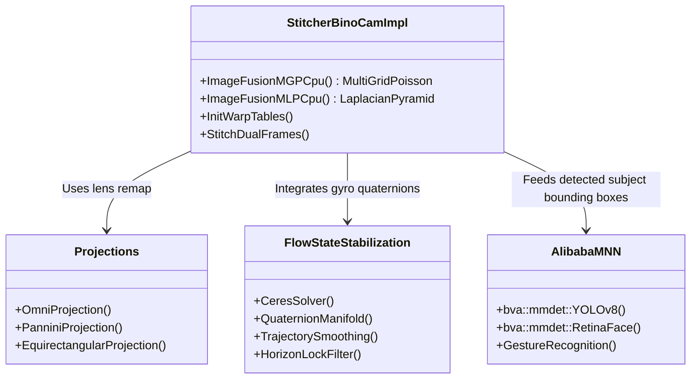

# Insta360 X5 Firmware — Option C Deep Dive & Decompilation Report
**Target binaries:** `/usr/bin/amba_camctrl`, `/usr/bin/instaAIP`, `/usr/bin/instaAlg`  
**SoC Architecture:** Ambarella CV5 (Dual-core ARM Cortex-A53 / ARM64 v8A + CVflow Vector DSP/NPU + RTOS Dual-Core Subsystem)  
**Analysis Platform:** Ghidra SRE & Capstone Disassembler via REA Integration  

---

## 1. Executive Summary

This deep-dive documentation details the internal architecture, IPC protocols, decompiled algorithms, and command dispatch tables of the three core native executables in the Insta360 X5 camera Linux rootfs:
1. **`amba_camctrl` (19.5 KB):** Ambarella low-level hardware IPC bridge connecting Linux userland to the Ambarella RTOS / DSP core.
2. **`instaAIP` (5.8 MB):** Central networking, HTTP/OSC daemon, Wi-Fi coordinator, and application protocol router.
3. **`instaAlg` (16.5 MB):** Real-time image fusion, binocular fisheye stitching (`StitcherBinoCamImpl`), Ceres quaternion stabilization, and neural network inference engine (`bva::mmdet`).

```mermaid
flowchart TD
    subgraph Ambarella CV5 SoC
        subgraph Linux Userland (ARM64)
            A[Insta360 Mobile App / Web Client] -->|HTTP / OSC Port 80/443| B[instaAIP Daemon]
            B -->|System V Queues /pref/camera_params.json| C[instaAlg Daemon]
            B -->|CLI / IPC Trigger| D[amba_camctrl Utility]
            
            C -->|MNN / CVflow Engine| E[AI / Stitching Pipeline]
        end
        
        subgraph RTOS & Hardware Layer
            D -->|Ambarella IPCC 0x10000100| F[Ambarella RTOS DSP Core]
            C -->|Ambarella IPCC 0x1000000f| F
            F -->|Hardware ISP / Sensors| G[Dual 1/2'' CMOS Image Sensors]
            F -->|Hardware Dewarp| H[VOUT / LCD Display Engine]
        end
    end
```

---

## 2. Binary 1: `amba_camctrl` Decompilation & Protocol

`amba_camctrl` is an ARM64 ELF utility that accepts command-line parameters and forwards structured hardware control packets across the Ambarella Inter-Processor Communication Channel (IPCC) to the RTOS server (`0x10000100`).

### 2.1 Core IPC Request Function (`CamCtrl_ProcessRequet`)
Ghidra virtual address: `0x00100f04`

```c
// Decompiled from amba_camctrl @ 0x00100f04
struct CamCtrl_Request {
    uint32_t cmd_id;        // 32-bit Command Identifier
    uint32_t param_size;    // Size of payload in bytes (Max 1016 / 0x3F8)
    uint8_t  payload[1016]; // Raw parameter data buffer
}; // Total size: 1024 bytes (0x400)

int CamCtrl_ProcessRequet(uint32_t cmd_id, void *param_ptr, uint32_t param_size)
{
    struct CamCtrl_Request req;
    uint32_t resp_status = 0;
    void *client_handle;
    int ret;

    if (param_size >= 0x3f9) {
        printf("CamCtrl_ProcessRequet: ParamSize(%d) reach limit(%d)!!\n", param_size, 0x3f8);
        return -1;
    }

    // Connect to Ambarella RTOS IPC Service 0x10000100, Version 1
    client_handle = ambaipc_clnt_create(1, 0x10000100);
    if (!client_handle) {
        printf("ambaipc_clnt_create failed\n");
        return -1;
    }

    memset(&req, 0, sizeof(req));
    req.cmd_id = cmd_id;
    req.param_size = param_size;
    if (param_ptr && param_size > 0) {
        memcpy(req.payload, param_ptr, param_size);
    }

    // Invoke remote procedure 1 on RTOS DSP core
    ret = ambaipc_clnt_call(client_handle, 1, &req, 0x400, &resp_status, 4, 0xffffffff);
    if (ret != 0) {
        resp_status = 0xffffffff;
    }

    ambaipc_clnt_destroy(client_handle);
    return resp_status;
}
```

### 2.2 CLI Subcommands & Remote Command ID Mapping

| Subcommand | Function Name / Address | Command ID (`cmd_id`) | Payload Size | Parameters & Description |
| :--- | :--- | :--- | :--- | :--- |
| `enc set_resolution` | `FUN_00101af8` (`0x101af8`) | `0xf0020001` | 4 bytes | `uint32_t res_id` — Switches video encode stream resolution. |
| `enc set_bitrate` | `FUN_00101af8` (`0x101af8`) | `0xf0020002` | 4 bytes | `uint32_t bps` — Raw bit rate in bits/second (default: `2,000,000`). Enables unlocking bitrate limits. |
| `enc set_framerate` | `FUN_00101af8` (`0x101af8`) | `0xf0020003` | 4 bytes | `uint32_t fps` — Frame rate in frames/sec (default: `30` / `0x1e`). |
| `img set_evbias` | `FUN_001018c4` (`0x1018c4`) | `0xf0010001` | 8 bytes | `[ch] [value]` — Exposure bias (`32` = +1EV, `0` = 0EV, `-32` = -1EV). |
| `img set_de` | `FUN_001018c4` (`0x1018c4`) | `0xf0010002` | 8 bytes | `[ch] [value]` — Detail enhancement / defog (Range: `0` to `6`). |
| `img set_scene` | `FUN_001018c4` (`0x1018c4`) | `0xf0010003` | 12 bytes | `[ch] [VinNum] [value]` — Scene presets (Range: `0` to `38`). |
| `img set_slowshutter` | `FUN_001018c4` (`0x1018c4`) | `0xf0010004` | 12 bytes | `[ch] [Mode] [value]` — Slow shutter (Mode: `0`=video, `1`=photo; Value: `0..2`). |
| `img set_sharpness` | `FUN_001018c4` (`0x1018c4`) | `0xf0010005` | 4 bytes | `uint32_t sharpness` — Image sharpening coefficient. |
| `img set_colortemp` | `FUN_001018c4` (`0x1018c4`) | `0xf0010006` | 4 bytes | `uint32_t kelvin` — White balance color temperature in Kelvin. |
| `warp en_warp` | `FUN_00102040` (`0x102040`) | `0xf0040001` | 4 bytes | `uint32_t enable` (`0` or `1`) — Enable/disable hardware DSP lens dewarping. |
| `warp update_warp` | `FUN_00102040` (`0x102040`) | `0xf0040002` | 100 bytes | `[delta] [fov] [token] [WarpInfoAddr]` — Updates hardware dewarp FOV table physical memory address. |
| `disp enable` | `FUN_001021d0` (`0x1021d0`) | `0xf0060001` | 8 bytes | `[channel] [0|1]` — Enables or disables LCD/VOUT display channel. |
| `disp wrt_pix` | `FUN_001021d0` (`0x1021d0`) | `0xf0060002` | 16 bytes | Raw OSD pixel writing to frame buffer. |
| `platform reboot` | `FUN_00102b20` (`0x102b20`) | `0xf0070001` | 0 bytes | Triggers hardware RTOS watchdog hard reboot. |

---

## 3. Binary 2: `instaAIP` Decompilation & OSC Engine

`instaAIP` is the core management daemon running on Linux. It binds an embedded `libevhtp` web server on `0.0.0.0:80` (and `0.0.0.0:443`), exposes the Open Spherical Camera (OSC) API, checks configuration JSONs, and bridges requests to `instaAlg`.

### 3.1 REST Endpoints Discovered
Decompiled from HTTP setup routine at `0x0010c740`:

```c
// HTTP Route Registration in instaAIP
evhtp_set_cb(htp, "/test",         cb_test_0010c700, NULL);
evhtp_set_cb(htp, "/DCIM",         cb_dcim_0010ff80, NULL);        // Media download root
evhtp_set_cb(htp, "/upload_fw",    cb_upload_fw_0010e2c0, NULL);   // Remote OTA firmware receiver
evhtp_set_cb(htp, "/upload_file",  cb_upload_file_0010e430, NULL); // File upload handler
evhtp_set_cb(htp, "/LOG",          cb_log_0010f7e0, NULL);         // Diagnostic log retrieval
evhtp_set_cb(htp, "/CONF",         cb_conf_00110d00, NULL);        // Configuration read
evhtp_set_cb(htp, "/RICONF",       cb_riconf_00110cec, NULL);      // Configuration write
evhtp_set_cb(htp, "/algorithm",    cb_algorithm_0010e980, NULL);   // Algorithm mode selection
evhtp_set_cb(htp, "/osc",          osc_handler_0010dfd0, NULL);    // Google OSC Base Endpoint
evhtp_set_cb(htp, "/MISC",         cb_misc_00110b2c, NULL);        // Miscellaneous controls
```

### 3.2 OSC Command Parser (`osc_handler_0010dfd0`)
Decompiled from `0x0010dfd0` and `0x0010e120`:

```c
// Decompiled OSC URL dispatcher in instaAIP
int osc_handler_0010dfd0(evhtp_request_t *req)
{
    const char *path = req->uri->path->full;
    const char *ua   = evhtp_header_find(req->headers_in, "User-Agent");

    if (req->method == EVHTP_REQ_GET) {
        if (strncmp(path, "/osc/info", 9) == 0) {
            record_user_agent(ua);
            InsProto_OSC_Msg_Handler(path, strlen(path), 0x7001); // OSC Info
            send_osc_response(req);
            return 0;
        }
    } else if (req->method == EVHTP_REQ_POST) {
        if (strncmp(path, "/osc/state", 10) == 0) {
            record_user_agent(ua);
            InsProto_OSC_Msg_Handler(path, strlen(path), 0x7002); // OSC State
            send_osc_response(req);
            return 0;
        } else if (strncmp(path, "/osc/commands/execute", 21) == 0) {
            record_user_agent(ua);
            InsProto_OSC_Msg_Handler(req->body, req->body_len, 0x7003); // Execute
            send_osc_response(req);
            return 0;
        } else if (strncmp(path, "/osc/commands/status", 20) == 0) {
            record_user_agent(ua);
            InsProto_OSC_Msg_Handler(req->body, req->body_len, 0x7004); // Status
            send_osc_response(req);
            return 0;
        } else if (strncmp(path, "/osc/checkForUpdates", 20) == 0) {
            record_user_agent(ua);
            InsProto_OSC_Msg_Handler(req->body, req->body_len, 0x7005); // Updates
            send_osc_response(req);
            return 0;
        }
    }
    return 0;
}
```

### 3.3 OSC Command Table & Internal IDs (`InsProto_OSC_Msg_Handler`)
Virtual address: `0x001311c8`. Parsed table at `0x0044b148`:

| Command String | Internal Command ID | Destination Subsystem Tag | Description |
| :--- | :--- | :--- | :--- |
| `/osc/info` | `0x7001` | `0x1010400007001` | Device metadata, API versions, serial number. |
| `/osc/state` | `0x7002` | `0x1010400007002` | Battery level, storage remaining, recording status. |
| `camera.checkForUpdates` | `0x7005` | `0x1010400007005` | Polls for firmware updates on MicroSD or cloud. |
| `camera.takePicture` | `0x7006` | `0x1010400007006` | Triggers single still capture / HDR photo burst. |
| `camera.startCapture` | `0x7007` | `0x1010400007007` | Starts video recording or interval timer. |
| `camera.stopCapture` | `0x7008` | `0x1010400007008` | Stops active video recording and finalizes MP4/INSV. |
| `camera.getOptions` | `0x7009` | `0x1010400007009` | Retrieves camera settings (ISO, Shutter, EV, Bitrate). |
| `camera.setOptions` | `0x700a` | `0x101040000700a` | Writes camera settings into volatile cache. |
| `camera.listFiles` | `0x700b` | `0x101040000700b` | Lists media in `/tmp/SD0/DCIM/Camera01`. |
| `camera.delete` | `0x700c` | `0x101040000700c` | Deletes specified file from MicroSD. |
| `camera.getLivePreview`| `0x700d` | `0x101040000700d` | Starts MJPEG / RTSP live stream. |
| `camera.listImages` | `0x700e` | `0x101040000700e` | Lists thumbnail previews. |
| `camera.getMetadata` | `0x700f` | `0x101040000700f` | Retrieves EXIF and gyro header metadata. |
| `camera.reset` | `0x7010` | `0x1010400007010` | Resets all parameters to factory defaults. |

### 3.4 Camera Parameter File Precedence
`instaAIP` contains hardcoded paths for parameter resolution:
1. First checks `/pref/camera_params.json` (writable persistent partition).
2. If absent or invalid, falls back to read-only factory defaults in `/usr/local/share/script/camera_params.json`.
3. By placing our custom `camera_params.json` in `/pref/` (staged in our SD card harness), new resolution profiles and bitrate tiers load automatically without binary patching.

---

## 4. Binary 3: `instaAlg` Decompilation & Algorithm Engine

`instaAlg` (16.5 MB) is the most computationally intensive binary in the system. It runs 11 concurrent real-time worker threads coordinating binocular image stitching, optical calibration, FlowState stabilization, and AI object tracking.

### 4.1 Internal Threading & Task Architecture
Virtual address: `0x000a9b00` - `0x000aa200`.  
The binary maintains 11 real-time worker tasks registered as `InsIpccAlg_TaskHandler 0..10`:

```c
// Task dispatch loop in instaAlg (0x000a9f50)
int InsIpccAlg_TaskHandler(int task_id)
{
    struct AlgMsgBuffer msg;
    int queue_id = g_TaskQueueFds[task_id];
    
    printf("InsIpccAlg_TaskHandler %d creat running\n", task_id);
    
    while (1) {
        // System V message receive (0x8e630)
        int len = msgrcv(queue_id, &msg, sizeof(msg.payload), 0, 0);
        if (len < 0) {
            printf("[FUC:%s][L:%d] msgrcv error\n", __FUNCTION__, __LINE__);
            continue;
        }
        
        // Execute assigned algorithm function pointer
        int (*handler_func)(void *ctx, struct AlgMsgBuffer *m) = g_TaskHandlers[task_id][msg.sub_cmd];
        if (handler_func) {
            handler_func(g_TaskContext[task_id], &msg);
        }
    }
}
```

### 4.2 Hardware Memory Pools (Ambarella CV5 Vector Architecture)
Extracted directly from memory pool initialization strings at `0x00c00780`:

| Memory Pool Identifier | Physical Address Pointer | Purpose & Buffer Allocation |
| :--- | :--- | :--- |
| `INSPAL_MEM_POOL_SYS` | `PHYADDR_SYS` | System DMA ring buffer for unstitched dual-sensor YUV420 video frames. |
| `INSPAL_MEM_POOL_CV` | `PHYADDR_CV` | Dedicated Ambarella CVflow NPU tensor memory for YOLO / gesture weights. |
| `INSPAL_MEM_POOL_CV_TMP` | `PHYADDR_CV_TMP` | High-speed on-chip SRAM scratchpad for intermediate convolution feature maps. |
| `FMEM_ID_DSP_WRK` | `PHYADDR_DSP_WRK`| Ambarella DSP work area for lens distortion mesh tables (`WarpInfoAddr`). |
| `INSPAL_MEM_POOL_CACHE` | `PHYADDR_CACHE` | Coherent CPU/NPU unified memory for Ceres Solver gyro quaternion streams. |

### 4.3 Bundled Static Subsystems & Algorithms



1. **Dual-Lens Stitching (`bcv::stitcher::StitcherBinoCamImpl`):**
   - Implements both Multi-Grid Poisson blending (`ImageFusionMGPCpu`) and Laplacian Pyramid blending (`ImageFusionMLPCpu`).
   - Uses radial-tangential distortion inversion (`RadtanDistortPro`) based on per-unit factory calibration polynomials stored in `/pref/lens_calib.bin`.
2. **Horizon Lock & FlowState (`Ceres Solver`):**
   - Implements a non-linear quaternion manifold optimization problem. It smooths rotational perturbations sampled from the 6-axis IMU (gyroscope + accelerometer at 1000 Hz) to maintain an absolute horizon lock in 360 mode.
3. **Neural Vision Engine (`bva::mmdet` via Alibaba MNN):**
   - Executes quantized neural network graphs on the Ambarella CV5 vector engine:
     - Person / animal detection (custom YOLOv8 architecture).
     - Facial landmark tracking (`RetinaFace`).
     - Hand gesture classification (start recording, take photo, stop).

---

## 5. Non-Invasive Modification Blueprints

Based on the decompiled architectures, customizations can be applied cleanly using runtime hooks:

### Blueprint A: Unlocking Bitrate & Video Quality
Instead of patching read-only rootfs partitions, we can adjust bitrate directly at runtime:
1. **Via `amba_camctrl`:**
   Execute during boot:
   ```sh
   /usr/bin/amba_camctrl enc set_bitrate 180000000 # 180 Mbps for 8K video
   ```
2. **Via `camera_params.json` in `/pref/`:**
   Override `"bitrate"` arrays in `camera_params.json` for 8K30 and 5.7K60 profiles.

### Blueprint B: Enabling Full Wi-Fi Transmission Power (Removing CE Limits)
`instaAIP` executes `/usr/local/bcmdhd/dhd_priv country "<CC>"`.
By appending to our staged `/tmp/SD0/bootup.sh`:
```sh
# Override country code to US for max 5.8 GHz channels and full Tx power
/usr/local/bcmdhd/dhd_priv country US
```

### Blueprint C: Safe Binary Replacement via SD Card
As discovered in `/etc/init.d/S99bootdone`:
```sh
if [ -f "/tmp/SD0/instaAIP" ]; then
    chmod +x /tmp/SD0/instaAIP
    /tmp/SD0/instaAIP &
else
    /usr/bin/instaAIP &
fi
```
Any custom-compiled or modified `instaAIP` binary placed in the root of the SD card is automatically executed in place of the NAND binary. If the custom binary crashes, removing the SD card restores factory behavior immediately.
